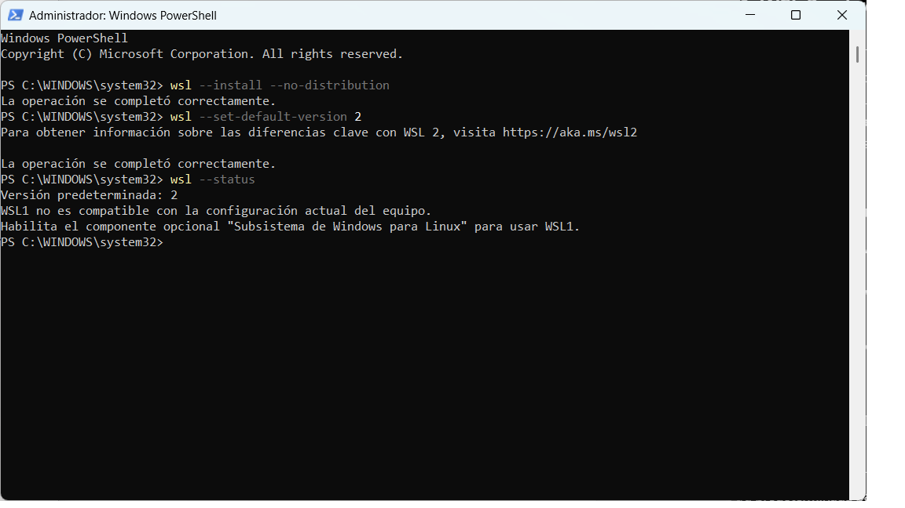
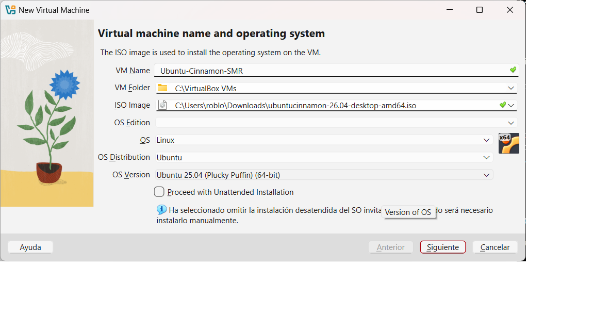
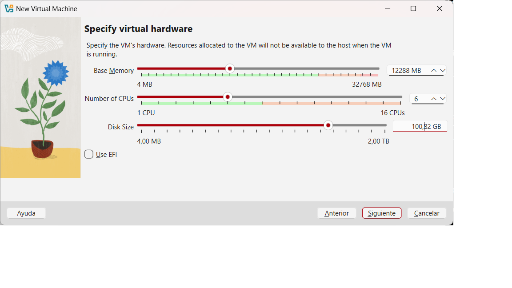
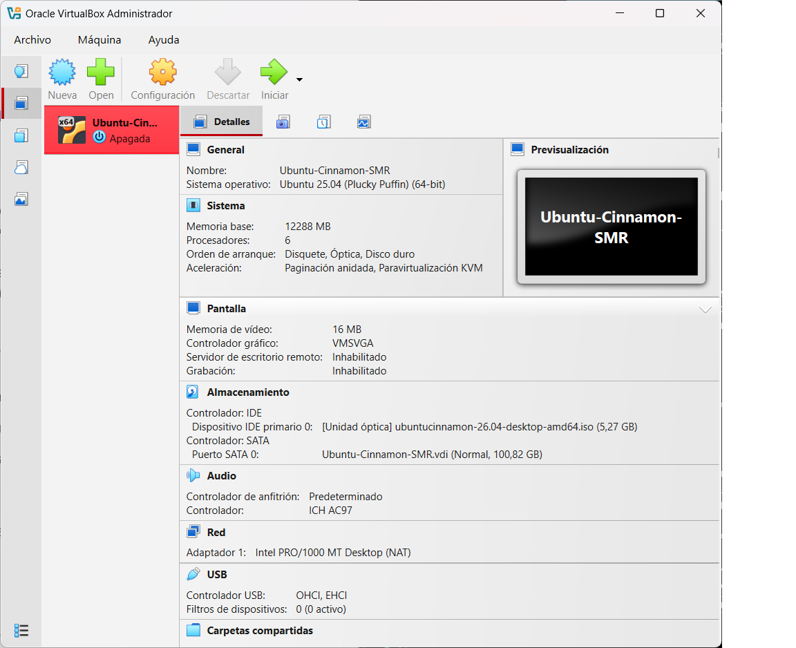
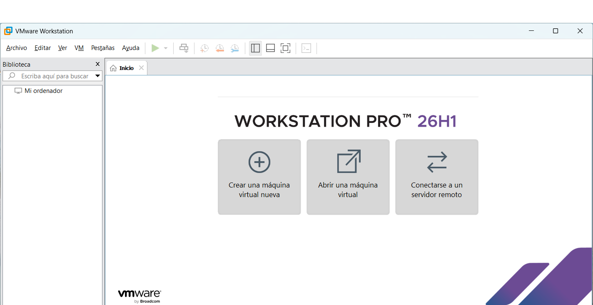
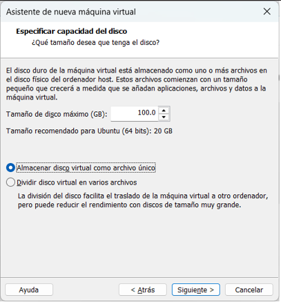
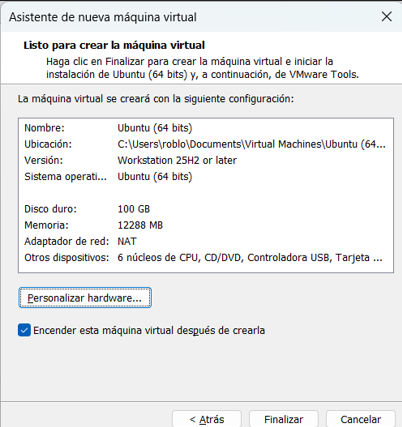

# Guía Técnica: Despliegue de Entornos Virtuales Linux para Ciberseguridad

**Máquina Virtual**  
Es un software que simula un ordenador físico, permitiendo ejecutar un sistema operativo invitado (*guest*) dentro de nuestro sistema anfitrión (*host*) de forma segura y sin comprometer el equipo principal.


1. [Introducción y conceptos clave](#introducción-y-conceptos-clave)
2. [Requisitos previos de hardware](#requisitos-previos-de-hardware)
3. [Método 1: WSL2 sobre Windows](#WSL2-sobre-Windows)
4. [Método 2: Oracle VM VirtualBox](#Oravle-VM-VirtualBox)
5. [Método 3: VMware Workstation Pro](#VMware-Workstation-Pro)
6. [Tabla comparativa y recursos](#Tabla-comparativa-y-recursos)


## 1. Introducción y conceptos clave

La virtualización permite aislar sistemas para realizar pruebas de seguridad sin alterar la configuración del equipo físico. Para entender este proceso exiten dos conceptos esenciales:

* **Sistema anfitrión (*host*):** Es el sistema operativo principal instalado directamente en el hardware de la máquina física (por ejemplo, Windows 11).
* **Sistema invitado (*guest*):** Es el sistema operativo vvirtualizado que se ejecuta de forma contenida (por ejemplo, Debian, Ubuntu server, Kali linux, etc...)


## 2. Requisitos previos de hardware

Antes de desplegar cualquier distribución, el procesador debe soportar virtualización por hardware y esta característica debe estar habilitada en la placa base:

> **Aviso importante:** Es imprescindible activar la opción **Intel Vt-X** o **AMD-V** desde la BIOS/UEFI del ordenador. Si esta función está deshabilitada, ningún hipervisor podrá arrancar una máquina virtual de 64 bits.

Para comprobar si la virtualización está activa en Windows sin reiniciar, pulsa: `Ctrl +  Shift + Esc` para abrir el *Administrador de tareas*, ve a la pestaña *Rendimiento* y consulta el estado en el apartado `Virtualización: Habilitado`.


## 3. Método 1: WSL 2 sobre Windows

El Subsistema de Windows para Linux (WSL 2) permite ejecutar un entorno Linux real directamente integrado en el sistema operativo anfitrión sin sobrecargar los recursos de hardware.

### Pasos de instalación y arranque

1. Abre el menú Inicio de Windows, escribe **PowerShell** y haz clic derecho seleccionando *Ejecutar como administrador*.
2. Escribe y ejecuta el comando de instalación automatizada:

3. Desde powershell como administrador:
```wsl --install --no-distribution```

4. Ahora configuramos WSL2 como arquitectura predeterminada para cualquier entorno futuro:
```wsl --set-default-version 2```

5. Reiniciamos el ordenador para cargar los módulos de virtualización en el arranque.

6. Comprobamos el estado del motor y la versión activa ejecutando:
```wsl --status```  


*Figura 1: Comprobación de estado y versión del kernel de WSL 2 en PowerShell.*


## 4. Método 2: Oracle VM VirtualBox

VirtualBox es un hipervisor de tipo 2 de código abierto y multiplataforma. A diferencia de WSL 2, permite la virtualización completa de sistemas operativos con interfaz gráfica dedicada, gestión de instantáneas (*snapshots*) y control exhaustivo del hardware emulado.

### Descarga de recursos oficiales

Para poner en marcha máquinas virtuales en VirtualBox con soporte completo de periféricos, es necesario descargar dos paquetes desde el sitio oficial:

* [Página oficial de descargas de VirtualBox y el Extension Pack (imprescindible para compatibilidad con USB 2.0/3.0 y tarjetas de red externas)](https://www.virtualbox.org/wiki/Downloads) 

### Procedimiento de instalación y parametrización

1. **Instalación de la aplicación base:**
   * Ejecuta el archivo instalador `.exe` de VirtualBox con permisos de administrador.
   * Continúa con el asistente aceptando los componentes predeterminados y confirma la advertencia de reinicio temporal de interfaces de red (*Network Interfaces*).
   * Pulsa en **Install** y finaliza el proceso.

2. **Instalación del Extension Pack:**
   * Haz doble clic sobre el archivo `.vbox-extpack` descargado.
   * En la ventana emergente de VirtualBox, haz clic en **Instalar**.
   * Baja la barra de desplazamiento del acuerdo de licencia hasta el final para habilitar el botón y pulsa **Acepto**.
   * Confirma la ventana de elevación de privilegios de Windows (*UAC*) para validar la instalación.

3. **Creación y configuración de la máquina virtual:**
   * En la ventana principal de VirtualBox, pulsa en **Nueva** (`Ctrl + N`).
   * Asigna un nombre al entorno (por ejemplo, `Ubuntu-Cinnamon-SMR`) y selecciona la carpeta de almacenamiento.
   * En el campo **Imagen ISO**, selecciona el archivo `.iso` descargado de Ubuntu Cinnamon (marca la opción *Omitir instalación desatendida* si deseas configurar manualmente usuarios y particiones).
   * **Memoria RAM:** Asigna al menos **4096 MB (4 GB)**.
   * **Procesadores:** Asigna al menos **2 CPUs** dentro de la franja verde.
   * **Disco duro virtual:** Selecciona formato **VDI** de asignación dinámica con un tamaño mínimo de **25 GB** a **30 GB**.
   * **Red:** En *Configuración > Red*, define el modo según la práctica: **NAT** para salida a Internet básica o **Adaptador puente** (*Bridged*) para que la máquina adquiera una dirección IP propia dentro de la red local física.
4. **Instalación del sistema operativo (Ubuntu Cinnamon):**
   * En la ventana principal de VirtualBox, selecciona la máquina virtual y pulsa en **Iniciar** (botón verde).
   * En el menú inicial de arranque de la ISO (*GRUB*), pulsa **Enter** sobre la opción **Try or Install Ubuntu Cinnamon**.
   * Una vez cargado el entorno en vivo, haz doble clic sobre el acceso directo **Instalar Ubuntu Cinnamon** en el escritorio (o el asistente automático que se abre).
   * **Idioma y teclado:** Selecciona **Español** para la interfaz y distribución del teclado.
   * **Tipo de instalación:** Elige **Instalación normal** y marca la opción de descargar actualizaciones y software de terceros para códecs.
   * **Particionado:** Selecciona **Borrar disco e instalar Ubuntu** (esto solo afectará al disco virtual `.vdi` asignado, sin tocar el disco del host Windows). Pulsa **Instalar ahora** y confirma los cambios.
   * **Configuración regional y usuario:** Selecciona tu zona horaria, define el nombre del equipo, tu usuario y una contraseña segura.
   * **Finalización:** Espera a que termine la copia de archivos. Cuando el asistente indique que la instalación ha concluido, pulsa en **Reiniciar ahora**. Si aparece en pantalla el mensaje *Please remove the installation medium, then press ENTER*, pulsa **Enter** para expulsar la imagen virtual y arrancar desde el disco duro virtual.

5. **Configuración inicial y Guest Additions:**
   * Inicia sesión con el usuario y contraseña creados.
   * Abre un terminal (`Ctrl + Alt + T`) y actualiza la lista de paquetes y el sistema:
     ```bash
     sudo apt update && sudo apt upgrade -y
     ```
   * **Instalación de utilidades de integración:** Para habilitar la resolución dinámica, el puntero integrado y el portapapeles compartido, instala los paquetes oficiales de soporte desde los repositorios:
     ```bash
     sudo apt install -y virtualbox-guest-utils virtualbox-guest-x11
     ```
   * Reinicia la máquina virtual para aplicar los controladores del entorno:
     ```bash
     sudo reboot
     ```
   * En el menú superior de la ventana de VirtualBox, dirígete a **Dispositivos > Portapapeles compartido** y selecciona **Bidireccional** para permitir copiar y pegar texto entre el anfitrión y el huésped.

   
   *Imagen 2: Configuración inicial VirtualBox*

   
   *Imagen 3: Elección de recursos*

   
   *Imagen 4: Dashboard principal con VM configurada*


   ## 5. Método 3: VMware Workstation Pro

### Procedimiento de instalación y preparación
* Descarga el instalador oficial de **VMware Workstation Pro** (licencia para uso persona, requiere registro previol).
* Ejecuta el instalador en Windows, acepta los términos de licencia y mantén seleccionada la opción para instalar las herramientas de teclado avanzadas y compatibilidad de Hyper-V/VBS si se solicita.
* Reinicia el equipo anfitrión si el asistente lo requiere para completar la integración de adaptadores de red virtuales.

### Creación y configuración de la máquina virtual
1. Abre VMware Workstation Pro y selecciona **Create a New Virtual Machine** (`Ctrl + N`).
2. Selecciona la opción **Typical (recommended)** y pulsa **Next**.
3. En la pantalla de origen del medio, selecciona **Installer disc image file (iso)**, haz clic en **Browse...** y selecciona la imagen `.iso` de Ubuntu Cinnamon.
4. **Configuración de hardware inicial:**
   * **Guest Operating System:** Linux.
   * **Version:** Ubuntu 64-bit.
   * **Virtual machine name:** Asigna un nombre identificativo (por ejemplo, `Ubuntu-Cinnamon-VMware`).
   * **Disk Capacity:** Define un tamaño de disco de al menos **30 GB**. Selecciona **Store virtual disk as a single file** (o dividirlo en múltiples archivos para facilitar portabilidad).
5. **Personalización avanzada del hardware (*Customize Hardware...*):**
   * **Memory:** Asigna **4096 MB (4 GB)** de memoria RAM.
   * **Processors:** Asigna al menos **2 núcleos de CPU** (o 4 núcleos si el host lo permite).
   * **Network Adapter:** Configurado en **NAT** (para acceso directo a Internet compartido) o **Bridged** (para visibilidad directa en la red física).
   * **Display (Aceleración gráfica):**
     * Marca la casilla **Accelerate 3D graphics**.
     * En **Graphics memory**, asigna **2 GB** o **4 GB** de memoria de vídeo (aprovechando directamente la GPU física del equipo).
6. Pulsa en **Close** y luego en **Finish** para registrar la máquina.

### Instalación del sistema y herramientas de integración
1. Inicia la máquina virtual pulsando en **Power on this virtual machine**.
2. Completa la instalación de Ubuntu Cinnamon (u otra distro) siguiendo el asistente gráfico (idioma, usuario y particionado del disco virtual).
3. Tras reiniciar e iniciar sesión en el escritorio, abre una terminal (`Ctrl + Alt + T`) e instala las utilidades nativas de integración de VMware:
   ```bash
   sudo apt update
   sudo apt install -y open-vm-tools open-vm-tools-desktop
   sudo reboot
  
 Con este último reinicio, el entorno queda completamente integrado con VMware Workstation, habilitando automaticamente ls sincronización de ratón, portapaeles bidireccional y controladores nativos del sistema.


*Imagen 5: Pantalla principal VMware workstation*

    
*Imagen 6: Configuración de disco virtual*

           
*Imagen 7: Configuración de parámetros finalizada*


## 6. Tabla comparativa de métodos de despliegue

| Criterio | Método 1 (WSL2) | Método 2 (VirtualBox) | Método 3 (VMware Workstation Pro) |
| :--- | :--- | :--- | :--- |
| **Aislamiento / Tipo** | Contenedor integrado / Núcleo compartido | Máquina virtual completa (Hipervisor Tipo 2) | Máquina virtual completa (Hipervisor Tipo 2) |
| **Rendimiento 3D / GPU** | Acceso directo por vGPU (CUDA / GUI directo) | Emulación básica / limitada a 256MB  | Aceleración gráfica por hardware (hasta 8 GB dedicados) |
| **Facilidad de uso** | Alta (integrado en terminal de Windows) | Alta (asistente gráfico amigable) | Media-Alta (mayor control de hardware virtual) |
| **Integración con Host** | Nativa (sistema de archivos y red compartidos) | Guest Additions (portapapeles, carpetas) | `open-vm-tools-desktop` (arrastrar y soltar fluido) |
| **Consumo de recursos** | Muy bajo (asignación dinámica de RAM) | Moderado | Alto (reserva fija de CPU, RAM y VRAM) |
| **Caso de uso ideal** | Desarrollo web/backend y herramientas CLI | Pruebas generales y entornos de laboratorio | Escritorios virtuales pesados y cargas gráficas |

---

## 7. Recursos y Referencias

* [Documentación oficial de Microsoft sobre WSL2](https://learn.microsoft.com/es-es/windows/wsl/)
* [Manual de usuario de Oracle VM VirtualBox](https://www.virtualbox.org/manual/)
* [Documentación oficial de VMware Workstation Pro](https://docs.vmware.com/en/VMware-Workstation-Pro/index.html)
* [Repositorio oficial y guía de open-vm-tools](https://github.com/vmware/open-vm-tools)
* [Ubuntu Cinnamon Remix - Sitio web y notas de lanzamiento](https://ubuntucinnamon.org/)

## Comandos útiles

Para consultar la configuración de red:
```bash
ip addr
```

Para comprobar la conectividad:
```bash
ping 8.8.8.8
```

## Gestión de servicios

Para consultar el estado de un servicio:
```bash
systemctl status <servicio>
```

Para reiniciar un servicio:
```bash
sudo systemctl restart <servicio>
```

## Gestión de usuarios

Para crear un nuevo usuario:
```bash
sudo useradd -m <nombre_usuario>
```

Para cambiar o asignar contraseña:
```bash
sudo passwd <nombre_usuario>
```
## Información del proyecto
Esta documentación se ha elaborado utilizando Markdown.
El control de versiones se realiza mediante Git
y el repositorio remoto se encuentra alojado en GitHub.